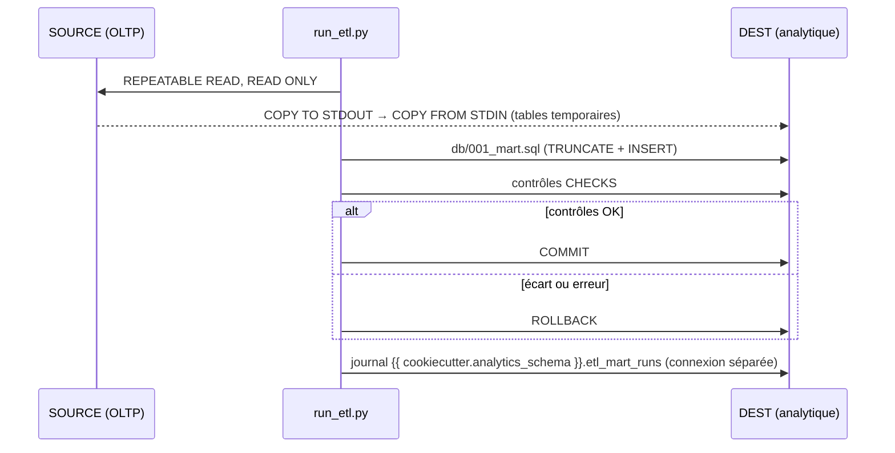

# ETL et data mart

`etl/run_etl.py` recharge entièrement les tables du data mart (schéma
`{{ cookiecutter.analytics_schema }}` de la base DEST) à partir de la base SOURCE.
La transformation est écrite en SQL dans `db/001_mart.sql`.

## Lancer un run

```bash
python etl/run_etl.py                              # run complet       (make etl)
python etl/run_etl.py --dry-run                    # tout puis ROLLBACK (make etl-dry-run)
python etl/run_etl.py --sql chemin/vers/autre.sql  # autre fichier de transformation
python etl/run_etl.py --lock-timeout 30s           # attente max du verrou sur les tables cibles
```

| Code de sortie | Sens |
|----------------|------|
| `0` | Succès |
| `1` | Échec, rollback effectué : l'API continue de servir les données précédentes |
| `2` | Un autre run est déjà en cours (verrou consultatif PostgreSQL) |

## Déroulé

Tout le travail côté DEST tient dans **une seule transaction** : soit tout est publié, soit rien.



1. **Extract** : photo cohérente de la source. Les tables sont streamées par `COPY` : la
   mémoire reste constante quel que soit le volume.
2. **Load** : tables temporaires (`ON COMMIT DROP`), indexées puis analysées. Aucune copie de
   l'OLTP ne reste après le run.
3. **Transform** : exécution de `db/001_mart.sql` avec `search_path = pg_temp` ; le SQL lit
   les tables temporaires sous leur nom source.
4. **Contrôles** : rapprochements bloquants (volumes, montants). Un écart annule le run.
5. **Journal** : une ligne par run dans `{{ cookiecutter.analytics_schema }}.etl_mart_runs`, écrite
   en autocommit pour qu'un échec reste visible malgré le rollback.

## Suivre les runs

```sql
SELECT run_id, started_at, status, duration_ms, rows_loaded, error
FROM {{ cookiecutter.analytics_schema }}.etl_mart_runs
ORDER BY run_id DESC
LIMIT 10;
```

`status` vaut `running`, `ok`, `dry_run`, `error` ou `skipped`.

## Adapter l'ETL au projet

Trois listes de `etl/run_etl.py` et un fichier SQL sont à modifier ensemble :

| Où | Quoi |
|----|------|
| `TABLES` | Tables source lues par le SQL : colonnes (liste blanche), colonnes exclues, filtre `where`, index |
| `db/001_mart.sql` | Création (idempotente) et remplissage des tables du mart |
| `MART_TABLES` | Tables produites, comptées et journalisées après la transformation |
| `CHECKS` | Requêtes renvoyant `(valeur_mart, valeur_référence)` ; un écart fait échouer le run |

```python
TABLES = (
    TableSpec(
        "orders",
        columns=("id", "customer_id", "amount", "created_at"),
        where="created_at >= now() - interval '2 years'",
        indexes=(("id",), ("customer_id",)),
    ),
)
```

!!! tip
    Ne copier que les colonnes réellement lues par le SQL : moins de volume, et aucune donnée
    sensible (mots de passe, données personnelles) dans la base analytique.

## Planifier

L'ETL est un script autonome : le lancer depuis un cron, un `CronJob` Kubernetes ou un DAG
Airflow. Le code de sortie `2` (run déjà en cours) n'est pas une erreur à alerter.
