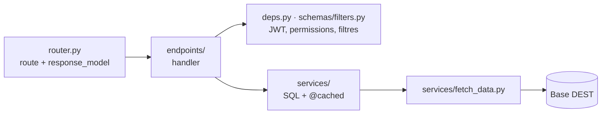

# Structure du projet

```text
{{ cookiecutter.project_slug }}/
├── app/
│   ├── main.py                  # bootstrap : middlewares, CORS, rate limit, erreurs, probes
│   ├── api/
│   │   ├── deps.py              # require_permission (claim JWT "perms")
│   │   ├── params.py            # paramètres de requête partagés (pagination)
│   │   └── v1/
│   │       ├── router.py        # déclaration centralisée de toutes les routes
│   │       └── endpoints/       # handlers, sans logique ni SQL
│   ├── core/                    # config, constantes, sécurité, cache, rate limit, logs, erreurs, santé
│   ├── db/session.py            # sessions async SOURCE et DEST
│   ├── schemas/                 # filtres (dépendances FastAPI) et modèles de réponse
│   └── services/                # logique métier et SQL (cache Redis via @cached)

├── db/001_mart.sql              # schéma et transformation du data mart
├── etl/run_etl.py               # ETL SOURCE -> DEST

├── docs/
│   ├── mkdocs.yml               # configuration de cette documentation
│   └── docs/                    # pages Markdown
├── tests/                       # tests de fumée (sans PostgreSQL ni Redis)
├── generate_test_token.py       # JWT de test pour Swagger
├── docker-compose.yml           # Redis (+ serveur de docs, profil "docs")
├── Dockerfile                   # image de l'API
├── Makefile                     # raccourcis
├── requirements.txt             # dépendances de l'API
└── requirements-docs.txt        # dépendances de la documentation
```

## Découpage en couches

Une requête traverse les couches dans un seul sens :



| Couche | Rôle | Interdit |
|--------|------|----------|
| `api/v1/router.py` | Enregistre chaque route : chemin, handler, tag, `response_model` | Logique |
| `api/v1/endpoints/` | Déclare les dépendances (filtres, permission) et appelle le service | SQL, calcul |
| `services/` | Écrit le SQL, calcule, met en cache | Accès à la requête HTTP |
| `services/fetch_data.py` | Exécute le SQL et renvoie des `dict` | Logique métier |
| `core/` | Briques techniques transverses | Code métier |

## Points d'entrée

- `app/main.py` : objet `app` lancé par uvicorn (`uvicorn app.main:app`).

- `etl/run_etl.py` : script autonome, lancé par un planificateur (cron, Airflow…).

- `generate_test_token.py` : outil de développement.
